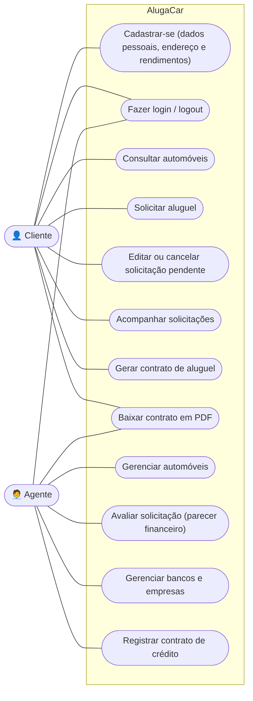
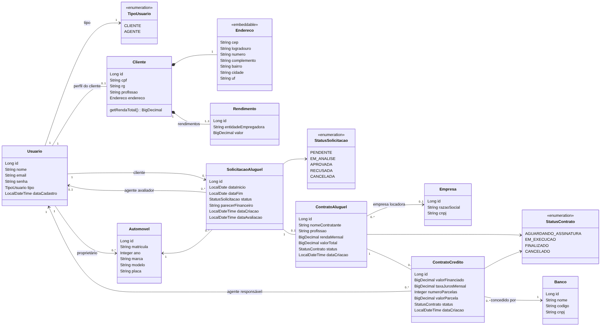
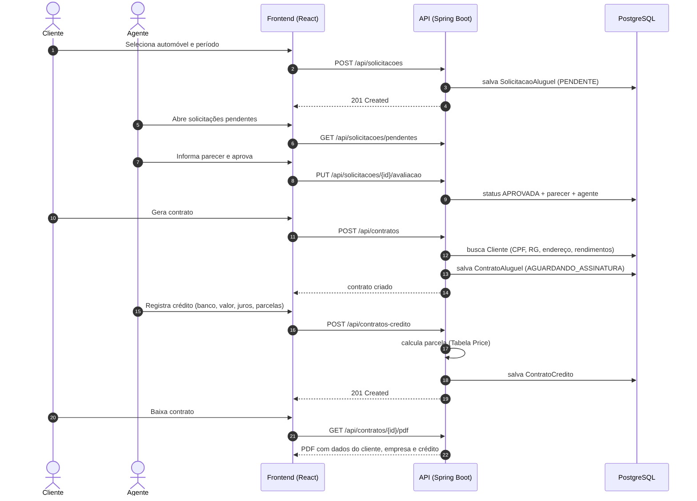
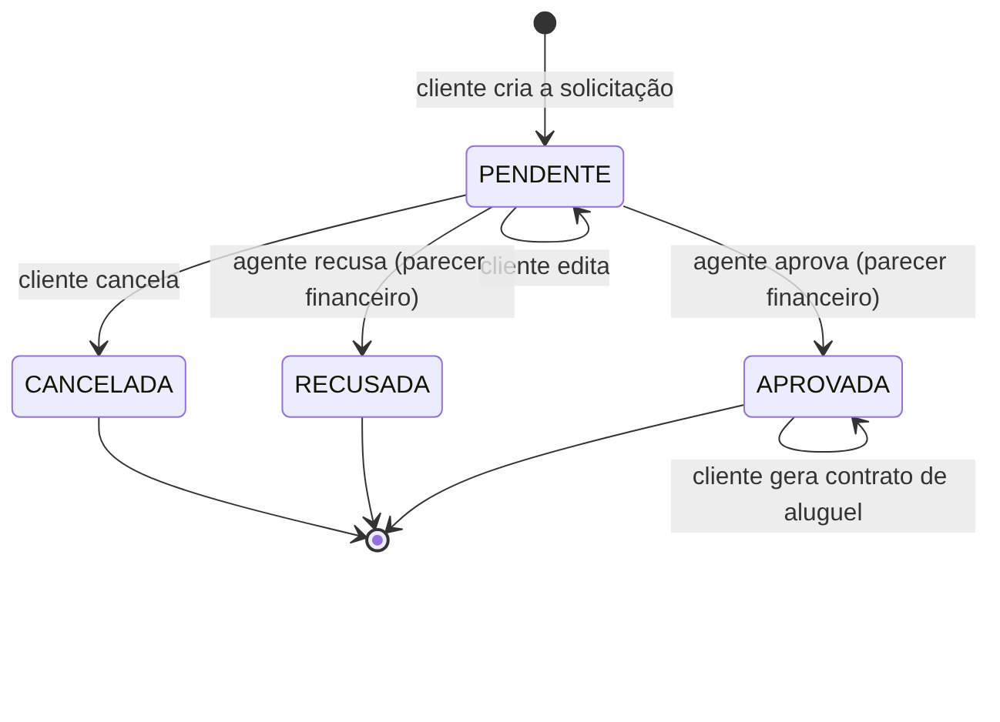
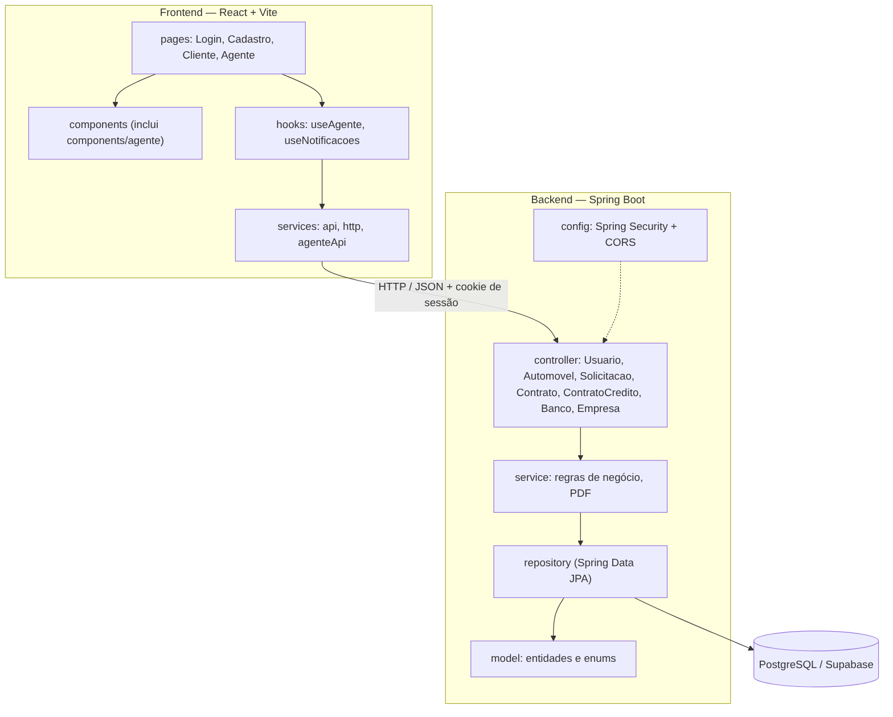

# Diagramas UML — AlugaCar

Os diagramas estão em [Mermaid](https://mermaid.js.org/) (arquivos `.mmd` em
`docs/uml/`, que o GitHub também renderiza) e em PNG.

## 1. Casos de uso

## 2. Diagrama de classes (modelo de domínio)

Decisões do modelo:

- `Usuario` guarda apenas a conta de acesso; `tipo` é o enum `TipoUsuario`.
- `Cliente` guarda CPF, RG, profissão, `Endereco` (embutido) e de 1 a 3
  `Rendimento` (limite validado no cadastro e em `Cliente.adicionarRendimento`).
- `Banco` e `Empresa` são entidades próprias; `ContratoCredito` liga um
  `ContratoAluguel` a um `Banco` (relação 1–1 com o contrato de aluguel).

## 3. Sequência — do pedido ao contrato de crédito

## 4. Estados da solicitação

## 5. Arquitetura em camadas

Para regenerar as imagens: `mmdc -i docs/uml/classes.mmd -o docs/uml/classes.png -b white -s 2`
(requer `@mermaid-js/mermaid-cli`).
